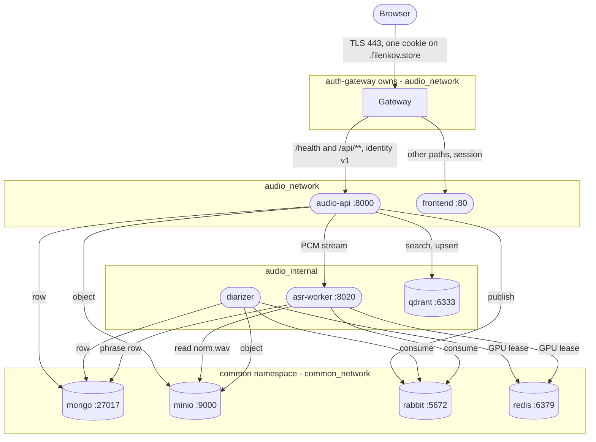

# audio

A recording becomes a chronological chat of phrases. A voice note is recognized while the person is speaking. Speakers start as numbers. A nick exists only after the owner assigns it. The namespace was moved in from the repository `ASR-Service` by [US-18](../user_stories/us-18-audio-namespace/init.md); the decision is [ADR-0012](../../adrs/12-audio-namespace.md). Mongo, MinIO, RabbitMQ and Redis are the [common](../common/init.md) services.

## Services

| Service | Code | Role in the block | Does not |
|---|---|---|---|
| `audio-api` | `audio-api` | The HTTP and WebSocket API. Upload, phrases, Range audio, voice notes, nicks, the voice index. | Run a model, check a role, verify a JWT |
| `diarizer` | `diarizer` | Consumes diarization and embedding messages. Writes `norm.wav`, speaker rows, the note embedding. | Serve a public route, read an identity header |
| `asr-worker` | `asr-worker` | Consumes transcription messages and the note PCM stream. Writes phrase text. | Serve a public route, read an identity header |
| `frontend` | `frontend` | The Vite React UI, served by nginx. Shell and calls: [frontend/design.md](frontend/design.md). | Hold a session, call anything but its own origin |
| `qdrant` | — | Qdrant `v1.13.4`, collection `audio_voices`. | Leave `audio_internal`, join `common_network` |

Endpoint behaviour is still owned by `../ASR-Service/docs/backend/audio-api/api.md`. This page does not copy it.

## Schema

`A -->|label| B` reads: A calls B; the label is the call. Rounded boxes run from this namespace; square boxes are neighbours.

`audio-api` also joins `audio_internal` and `common_network`. `diarizer` and `asr-worker` also join `common_network`. `frontend` is only on `audio_network`. `qdrant` is only on `audio_internal`.

## Networks

| Network | Why | Source |
|---|---|---|
| `audio_network` (external to the gateway) | The gateway reaches `audio-api:8000` and `frontend:80` by those names. | [ADR-0012](../../adrs/12-audio-namespace.md), [upstreams](../auth-gateway/external-contracts/upstreams.md) |
| `audio_internal` | `audio-api` to `qdrant:6333` and `asr-worker:8020`. Workers do not join `audio_network`. | [ADR-0012](../../adrs/12-audio-namespace.md) |
| `common_network` (external) | Mongo `mongo:27017` database `audio`, MinIO `minio:9000` bucket `audio`, RabbitMQ `rabbit:5672`, Redis `redis:6379` for the GPU lease. | [common](../common/init.md), [ADR-0008](../../adrs/8-common-data-services.md) |

No container publishes a host port. Compose service names stay `audio-api`, `diarizer`, `asr-worker`, `frontend`, `qdrant`, so the gateway upstream strings stay `audio-api:8000` and `frontend:80`. Container names are `audio-<service>`, including `audio-qdrant`.

The Qdrant volume is `audio_ns_qdrant`. The weight volume is `audio_ns_hf`. Both are created empty. They are not the old project volumes `audio_qdrant_storage` and `audio_hf_home`. This namespace does not dump or delete the Mongo database `audio` or the MinIO bucket `audio`.

`HF_TOKEN` is set on `diarizer` and `asr-worker` only. Compose does not pass the namespace env file into `audio-api`, so that process does not receive the token.

## Identity this block consumes

The gateway authenticates `audio.filenkov.store` and forwards the caller. `audio-api` reads `X-Auth-Subject` and requires a canonical lower-case UUID (`8-4-4-4-12`; upper-case hex is stored lower-case). A missing subject, a non-UUID, or a request that carries only a pre-v1 user-id header is `401` with `error_code` `IDENTITY_MISSING`. `audio-api` does not read roles. The header set is owned by [identity v1](../auth-gateway/external-contracts/identity-v1.md). The host policy, including `microphone=(self)`, is owned by the gateway config and [upstreams](../auth-gateway/external-contracts/upstreams.md).

`X-Auth-Subject` must be a canonical lower-case UUID because object keys are `u/{uuid}/` and Mongo stores that value as `owner_user_id`. This is the external condition in [US-18](../user_stories/us-18-audio-namespace/init.md) D4, the same kind of condition as [US-16](../user_stories/us-16-rag-namespace/init.md) D6. The edge as it stands writes the Keycloak `sub`, which is not a UUID. This namespace does not change that issuer. Workers keep `owner_user_id` from the queue message.

## Mismatches

The legacy tree `../ASR-Service` is not rewritten. Rows below are what that tree says and what this namespace requires.

| # | Where (legacy file) | Legacy doc says | This namespace requires |
|---|---|---|---|
| 1 | `docs/external_contracts/auth-gateway/route-and-headers.md`, `docs/adrs/ADR-001-gateway-identity-headers.md`, `constitution.md` | The pre-v1 user header is the only user key. The pre-v1 role header is unused for access | `X-Auth-Subject` only ([identity v1](../auth-gateway/external-contracts/identity-v1.md)). No role check in `audio-api` |
| 2 | `docs/external_contracts/auth-gateway/route-and-headers.md` | On 2026-11-01 the host was absent. `/api/*` is `auth: session`. `role_field: global_role`. Shared `Permissions-Policy` blocks the microphone | The gateway config already has the host: `/health` public, `/api/**` is `service(audio, family, admin)`, other paths `session`, `microphone=(self)`. Upstream strings have no `http://` prefix |
| 3 | `docs/external_contracts/auth-gateway/route-and-headers.md` | Rate limit 180 requests per minute per IP | The gateway default in `config.yaml` is 600 per minute. The audio host does not override it. This story does not change that file |
| 4 | `deploy/docker-compose.yml`, `README.md` | Qdrant is on `common_network`. `audio-api` joins `deploy_auth_network` (compose key `auth_network`). Container names are `audio_qdrant`, `audio_api`, `audio_frontend` | `audio_network`, `audio_internal`, `common_network`. Qdrant only on `audio_internal`. Containers `audio-<service>` |
| 5 | `deploy/docker-compose.yml`, service `config.py` | `S3_ACCESS_KEY` and `S3_SECRET_KEY` default to a well-known MinIO pair. `RABBITMQ_URL` defaults to a URL with `guest` userinfo | No credential default in committed files. Required keys are empty in `.env.example` and `make doctor` fails while they are empty |
| 6 | `deploy/docker-compose.yml` | Volumes `qdrant_storage` and `hf_home` on the old compose project `audio` | New volumes `audio_ns_qdrant` and `audio_ns_hf`, started empty. The old volumes are not mounted |
| 7 | `docs/backend/audio-api/api.md` | Owns the endpoint table, including the pre-v1 header name | Not copied. `src/audio/audio-api/tests/test_api_contract.py` still reads this legacy file, because `docs/backend/audio-api/api.md` does not exist in this repository |

The gateway compose joins `audio_network` as `external: true`, the same attachment as `rag_network` ([ADR-0011](../../adrs/11-gateway-joins-rag-network.md)).

## What this page does not own

- The page shell and its calls: [frontend/design.md](frontend/design.md).
- A service's endpoints: the legacy `docs/backend/audio-api/api.md` until this namespace has its own API contract page.
- Where a request enters: [docs/init.md](../init.md), [upstreams](../auth-gateway/external-contracts/upstreams.md).
- The header names: [identity v1](../auth-gateway/external-contracts/identity-v1.md).
