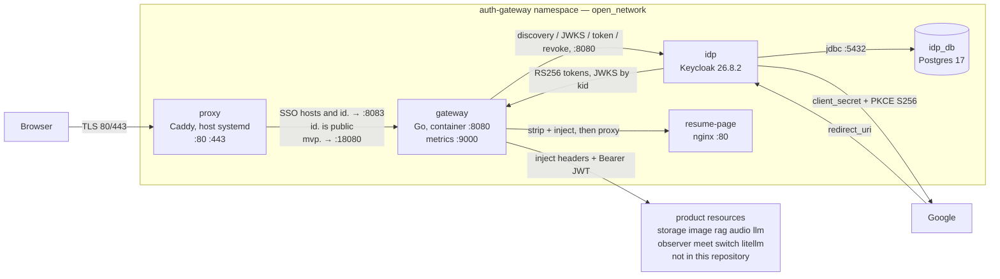

# auth-gateway

Identity and edge. The services share `open_network`, [auth-gateway/.env.example](../../deploy/auth-gateway/.env.example), and [auth-gateway/docker-compose.yaml](../../deploy/auth-gateway/docker-compose.yaml).

This page is how the services interact. Contracts for each service are linked, not copied.

## Schema

## What auth-gateway requests

| Link | Kind | Resource or action |
|---|---|---|
| Google | action | Sign the user in. Redirect URI: `https://id.filenkov.store/realms/filenkov/broker/google/endpoint` |

`hermes` (`127.0.0.1:9119`) and `lite-llm` (`127.0.0.1:4000`) are not part of this SSO contract. The proxy forwards them and auth-gateway does not authenticate them.

## Services

| Service | Role in the block | Does not |
|---|---|---|
| proxy | Terminates TLS, redirects HTTP to HTTPS, sets HSTS. One upstream per host. | Route by application, authorize, set application headers |
| gateway | BFF, route policy, identity injection, reverse proxy, `/admin` | Store users, issue tokens, store sessions, terminate TLS, render UI |
| idp | Users, roles, sessions, tokens. Google is the only login. | Proxy, route, know hosts |
| idp_db | Postgres state for idp | Anything else |
| resume-page | Static showcase and the `/admin` UI. Documented under [frontend/](frontend/). | Hold tokens, authorize, know secrets |

## Ports

[Compose](../../deploy/auth-gateway/docker-compose.yaml) publishes gateway `127.0.0.1:${GATEWAY_PORT:-8080}:8080` and metrics `127.0.0.1:${METRICS_PORT:-19000}:9000`. The container listens on `:8080` and `:9000`. [`.env.example`](../../deploy/auth-gateway/.env.example) sets `GATEWAY_PORT=8083`. The [Caddyfile](../../deploy/auth-gateway/Caddyfile) sends the SSO hosts and `id.` to `8083`. `id.` has no source gate ([ADR-0013](adrs/13-idp-host-public.md)). `mvp.` goes to `18080` (`make up-mvp`). `meet.` goes to `127.0.0.1:8000` and never enters this diagram.

Gateway stores nothing. The session cookie holds the Keycloak refresh token. idp remembers users, roles, and sessions.

## Ownership

| Fact | Owner |
|---|---|
| Who the user is, and their roles | idp |
| Who may call whom | gateway |
| TLS and HSTS | proxy |
| What the page shows | resume-page |

Who-may-edit-whom is enforced in gateway. Who-you-are stays in idp.
