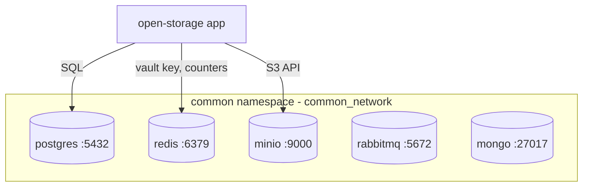

# common

Shared data services for every product that joins `common_network`. One network, one env file, one compose file. The decision is [ADR-0008](../../adrs/8-common-data-services.md). Service names and env keys are the ones in Common `docker-compose-common.yml` and `.env.common`.

## Services

| Service | DNS name | Port | Host publish | State |
|---|---|---|---|---|
| `postgres` | `postgres` | 5432 | no | volume `postgres_data` |
| `redis` | `redis` | 6379 | no | volume `redis_data` |
| `minio` | `minio` | 9000 API, 9001 console | 9000, 9001 | `/media/aleksey/HardDisk/minio` |
| `rabbitmq` | `rabbitmq`, alias `rabbit` | 5672 AMQP, 15672 management | no | volume `rabbitmq_data` |
| `mongo` | `mongo` | 27017 | no | volume `mongo_data` |

Postgres and MinIO read [`.env`](../../deploy/common/.env.example): `POSTGRES_USER`, `POSTGRES_PASSWORD`, `MINIO_ROOT_USER`, `MINIO_ROOT_PASSWORD`. The compose file does not set `POSTGRES_DB`. The image creates one database named after `POSTGRES_USER`. Each product creates its own database in this server. Mongo is one server; each product uses its own database inside it.

`open-storage` calls `postgres:5432`, `redis:6379` and `minio:9000`. It does not open RabbitMQ or Mongo. Those two stay here so another product can. See [open-storage](../open-storage/init.md).

## Schema

