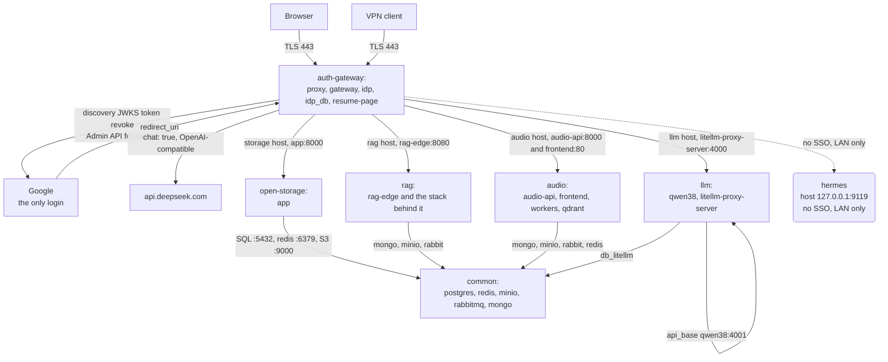

# System

One namespace is one block. A link is an action the block requests, or a resource it uses.

Every host on `filenkov.store` enters through the proxy. The gateway authenticates the hosts it receives, decides per route whether that caller may pass, and forwards the request with the identity of the caller attached. Hosts the proxy does not send to the gateway are listed below.

## Namespaces

 - auth-gateway: IdP (Keycloak), Proxy (Caddy), Gateway (Go service)
    - Description: The gateway is on the request path of the hosts it receives. Proxy terminates TLS. Gateway owns routing, policy, the sign-in flow and `/admin`. idp owns users, roles and sessions. Callers receive ([identity v1](auth-gateway/external-contracts/identity-v1.md)).
    - Detail inside the block: [auth-gateway/init.md](auth-gateway/init.md).
 - open-storage: App (FastAPI)
    - Description: The storage product. The app joins `open_network`. Its database, bucket and cache are the [common](common/init.md) services.
    - Detail inside the block: [open-storage/init.md](open-storage/init.md).
 - common: Postgres, Redis, MinIO, RabbitMQ, Mongo
    - Description: Shared data services on `common_network`. Other products join that network and use the service names.
    - Detail inside the block: [common/init.md](common/init.md).
 - rag: RAG-Chat (rag-edge, file-collector, processor, deletion-worker, chat, frontend, embedding, ocr, qdrant)
    - Description: The retrieval-augmented chat product over a user's own documents. `rag-edge` is the only inbound path and joins `rag_network`. Its documents, objects and queues are the [common](common/init.md) services; Qdrant stays here.
    - Detail inside the block: [rag/init.md](rag/init.md).
 - audio: audio-api, diarizer, asr-worker, frontend, qdrant
    - Description: A recording becomes a phrase chat, and a voice note is recognized as speech happens. The gateway is the only inbound path and joins `audio_network`. Mongo, MinIO, RabbitMQ and the Redis GPU lease are the [common](common/init.md) services; Qdrant stays here.
    - Detail inside the block: [audio/init.md](audio/init.md). The host and the upstreams are [upstreams](auth-gateway/external-contracts/upstreams.md).
 - llm: qwen38 (llama.cpp), litellm-proxy-server
    - Description: The chat model tandem. The router answers OpenAI-compatible calls and forwards to the server by name on `common_network`. Its bookkeeping is the `common` Postgres (`db_litellm`). The gateway reaches the router as `litellm-proxy-server:4000`; the proxy serves `lite-llm.` itself.
    - Detail inside the block: [llm/init.md](llm/init.md).

A namespace gets a directory when its first service exists. The shape is ([repository-layout.md](repository-layout.md)).

# Architecture

`A -->|label| B` reads: A acts on B; the label is the call and the port. A dashed edge is a resource the block reaches by name, not a process this repository runs. Rounded boxes are processes this repository runs; square boxes are the systems and the namespace around them. The contents of a namespace are not drawn here.

The internals of `auth-gateway` — proxy, gateway, idp, idp_db, resume-page, their ports and their calls — are ([auth-gateway/init.md](auth-gateway/init.md)).

## What the block requests

| Link | Kind | Resource or action |
|---|---|---|
| browser, VPN client | action | One sign-in on the hosts the gateway serves; the cookie domain is `.filenkov.store` |
| Google | action | Sign the user in. Redirect URI `https://id.filenkov.store/realms/filenkov/broker/google/endpoint` |
| product resources | resource | Reachable only from `open_network` plus the named product network; identity arrives in headers, never from the client |
| storage | resource | `app:8000` on `open_network`. The namespace is [open-storage/init.md](open-storage/init.md) |
| common data | resource | `postgres:5432`, `redis:6379`, `minio:9000` on `common_network`. RabbitMQ (`rabbitmq`, alias `rabbit`) and `mongo:27017` are on that network for other products. The namespace is [common/init.md](common/init.md) |
| hermes | resource | Forwarded by proxy, never reach gateway, keeps its own authentication |
| llm router | resource | `litellm-proxy-server:4000` on `common_network`. The namespace is [llm/init.md](llm/init.md) |
| deepseek | resource | `POST /api/chat` on the apex host, served by the gateway itself |

Upstream names, hosts and per-host policy rows are owned by ([upstreams](auth-gateway/external-contracts/upstreams.md)). The consumer-side obligations are ([identity v1](auth-gateway/external-contracts/identity-v1.md)).

## Where a request goes

1. Proxy terminates TLS and sets HSTS. It does not use one backend. The classes are in [deploy/auth-gateway/Caddyfile](../deploy/auth-gateway/Caddyfile):
   - `filenkov.store`, `storage.`, `image.`, `rag.`, `audio.`, `llm.`, `observer.`, `id.` → `127.0.0.1:8083`. `id.` is public ([ADR-0013](auth-gateway/adrs/13-idp-host-public.md))
   - `meet.filenkov.store` → `127.0.0.1:8000`, no SSO and not the gateway, LAN / WireGuard only
   - `hermes.` → `127.0.0.1:9119`, `lite-llm.` → `127.0.0.1:4000` (the `llm` router's published port, [llm/init.md](llm/init.md))
2. When the request reaches the gateway, it matches host, then path, then method. First match wins. Each host has exactly one `/**`, last.
3. Anonymous browser navigation becomes `302 /auth/login?return_to=…`. Anonymous `/api/*` becomes `401`. A wrong role becomes `403`. `deny` answers `404`.
4. Gateway strips every inbound identity header, verifies the access token, and injects `X-Auth-*` plus a `Bearer` the client cannot have written.
5. Gateway proxies to the upstream, or answers itself: `/auth/*`, `/admin/*`, `POST /api/chat`, `/healthz`, `/readyz`, `/metrics` on a second listener.

[`.env.example`](../deploy/auth-gateway/.env.example) sets `GATEWAY_PORT=8083`, which is the port the live sites use, and the Makefile declares the same default. Compose falls back to `8080` only when `GATEWAY_PORT` is unset.

The full path with ports and host classes is ([auth-gateway/init.md](auth-gateway/init.md)). Route syntax, startup rules, `/auth` and `/admin` belong to ([gateway API contract](auth-gateway/gateway/api-contract.md)).

## What is not here

- Storage runs in this repository: [open-storage/init.md](open-storage/init.md). Its Postgres, MinIO and Redis are [common](common/init.md). Which names the gateway proxies, and which the proxy serves itself, are in [upstreams](auth-gateway/external-contracts/upstreams.md).
- Audio runs in this repository: [audio/init.md](audio/init.md). Its Mongo, MinIO, RabbitMQ and Redis are [common](common/init.md). The host enters through the gateway.
- The LLM tandem runs in this repository: [llm/init.md](llm/init.md). The old `llama.cpp` startup script and `llama_proxy_lite/` are no longer authoritative.
- `docs/init.md` draws the map. A service's own behaviour is never restated here — it is linked.

## Decisions that bind the shape

([adrs/init.md](../adrs/init.md)) owns system-wide decisions: one contract version, roles in the token, one session store, shared data services on `common_network`, published images on `REGISTRY` ([images.md](images.md)). Namespace decisions for the edge are ([auth-gateway/adrs/init.md](auth-gateway/adrs/init.md)). Namespace decisions for storage are ([open-storage/adrs/init.md](open-storage/adrs/init.md)).
