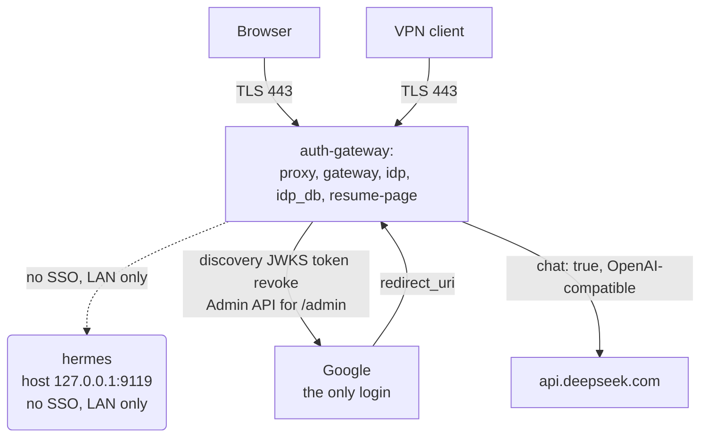

# System

One namespace is one block. A link is an action the block requests, or a resource it uses.

Every host on `filenkov.store` enters through one edge. The edge authenticates the caller once, decides per route whether that caller may pass, and forwards the request with the identity of the caller attached.

## Namespaces

 - auth-gateway: IdP (KeyCloak), Proxy (Caddy), Gateway (Go service)
    - Description: The only namespace in the tree, and the only one on the request path of every host. Proxy terminates TLS. Gateway owns routing, policy, the sign-in flow and `/admin`. idp owns users, roles and sessions. The product applications it fronts are outside this repository and receive ([identity v1](auth-gateway/external-contracts/identity-v1.md)).
    - Detail inside the block: [auth-gateway/init.md](auth-gateway/init.md).

Planned, not in the tree: `common` (shared data plane: MinIO, observability, registry) and `web-storage` (first product application). Both take the shape in ([repository-layout.md](repository-layout.md)). A namespace gets a directory when its first service exists, not before.

# Architecture

`A -->|label| B` reads: A acts on B; the label is the call and the port. A dashed edge is a resource the block reaches by name, not a process this repository runs. Rounded boxes are processes this repository runs; square boxes are the systems and the namespace around them. The contents of a namespace are not drawn here.

The internals of `auth-gateway` — proxy, gateway, idp, idp_db, resume-page, their ports and their calls — are ([auth-gateway/init.md](auth-gateway/init.md)).

## What the block requests

| Link | Kind | Resource or action |
|---|---|---|
| browser, VPN client | action | One sign-in on any host; the cookie domain is `.filenkov.store` |
| Google | action | Sign the user in. Redirect URI `https://id.filenkov.store/realms/filenkov/broker/google/endpoint` |
| product resources | resource | Reachable only from `open_network` plus the named product network; identity arrives in headers, never from the client |
| hermes, lite-llm | resource | Forwarded by proxy, never reach gateway, keep their own authentication |
| deepseek | resource | `POST /api/chat` on the apex host, served by the gateway itself |

Upstream names, hosts and per-host policy rows are owned by ([upstreams](auth-gateway/external-contracts/upstreams.md)). The consumer-side obligations are ([identity v1](auth-gateway/external-contracts/identity-v1.md)).

## Where a request goes

1. Proxy terminates TLS, sets HSTS, forwards to `127.0.0.1:8083` — one backend for eight hosts.
2. Gateway matches host, then path, then method. First match wins. Each host has exactly one `/**`, last.
3. Anonymous browser navigation becomes `302 /auth/login?return_to=…`. Anonymous `/api/*` becomes `401`. A wrong role becomes `403`. `deny` answers `404`.
4. Gateway strips every inbound identity header, verifies the access token, and injects `X-Auth-*` plus a `Bearer` the client cannot have written.
5. Gateway proxies to the upstream, or answers itself: `/auth/*`, `/admin/*`, `POST /api/chat`, `/healthz`, `/readyz`, `/metrics` on a second listener.

The full path with ports and host classes is ([auth-gateway/init.md](auth-gateway/init.md)). Route syntax, startup rules, `/auth` and `/admin` belong to ([gateway message contract](auth-gateway/gateway/API/api-contract.md)).

## What is not here

- Product applications: storage, image, rag, audio, llm, observer, meet, switch, litellm. Each keeps its own compose, network and data; each reads identity v1.
- `docs/init.md` draws the map. A service's own behaviour is never restated here — it is linked.

## Decisions that bind the shape

([adrs/init.md](../adrs/init.md)) owns system-wide decisions: one contract version, roles in the token, one session store. Namespace decisions, including the edge-in-one-process shape, are ([auth-gateway/adrs/init.md](auth-gateway/adrs/init.md)).

## Mismatches: docs and code

Found while drawing this map. Each is left for its owner document to settle.

| Fact | Docs say | Code says |
|---|---|---|
| `id.filenkov.store` in the proxy | one of the eight hosts that reach the gateway, same class as `storage.` and the rest | `Caddyfile` sends it to `127.0.0.1:18080` beside `mvp.filenkov.store`; the eight public sites go to `127.0.0.1:8083` ([MISMATCH: deploy/auth-gateway/Caddyfile](auth-gateway/proxy/API/Message-contract.md)) |
| live gateway port | `127.0.0.1:8083`, in both the proxy and the gateway contract | compose publishes `127.0.0.1:${GATEWAY_PORT:-8080}`; `8083` comes only from an env value nobody commits ([MISMATCH: deploy/auth-gateway/docker-compose.yaml](auth-gateway/gateway/API/api-contract.md)) |
| idp's own console policy | `GET /admin/users` is `admin` only, and the console is reachable for break-glass | the `id.` host is `identity: passthrough`, `policy: public` on `/**` — anyone who reaches the name gets the console ([MISMATCH: src/auth-gateway/gateway/config.yaml](auth-gateway/gateway/API/api-contract.md)) |
| Gateway Go budget | 4200 lines, tests excluded ([ADR-0007](auth-gateway/adrs/7-gateway-line-budget.md)) | `find … ! -name '*_test.go' \| xargs cat \| wc -l` = 4953 ([MISMATCH: src/auth-gateway/gateway](auth-gateway/adrs/7-gateway-line-budget.md)) |
| `llm` upstream | `qwen38:4001` ([upstreams](auth-gateway/external-contracts/upstreams.md)) | the owl's model is `api.deepseek.com/v1`, `deepseek-flash` ([MISMATCH: src/auth-gateway/gateway/config.yaml](auth-gateway/gateway/API/api-contract.md)) |
