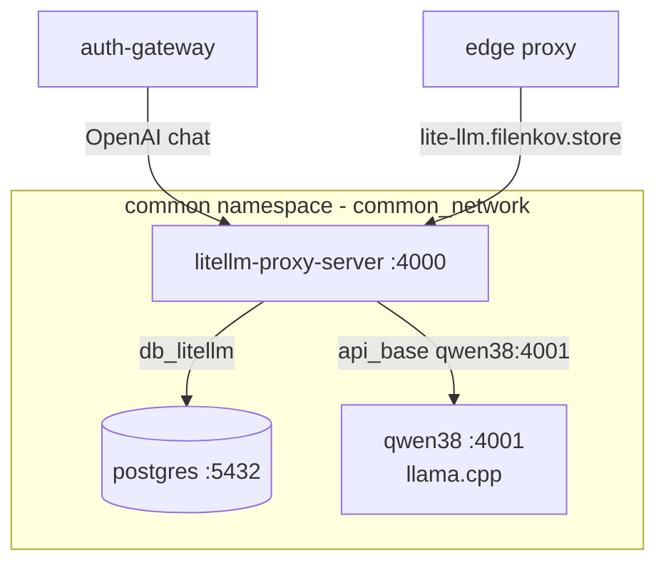

# llm

The chat model tandem. One llama.cpp server holds the weights, one LiteLLM router in front of it answers OpenAI-compatible calls. The decision is [ADR-0013](../../adrs/13-llm-namespace.md). Both services join `common_network`; the namespace creates no network.

## Services

| Service | Container | DNS name | Port | Host publish | State |
|---|---|---|---|---|---|
| `qwen38` | `qwen38` | `qwen38` | 4001 | no | bind `/media/aleksey/HardDisk/gguf_models:/models`, read-only |
| `litellm-proxy` | `litellm-proxy-server` | `litellm-proxy-server` | 4000 | no | `db_litellm` in the `common` Postgres |

The server image is `ghcr.io/ggml-org/llama.cpp:server-cuda12` and takes the whole card (`nvidia.com/gpu=all`, `-ngl -1`). The model is `/models/HuiHui/qwen3.8/model_q8.gguf`, context 128000. The router image is `ghcr.io/berriai/litellm:main-latest` and reads [config.yaml](../../deploy/llm/config.yaml).

`config.yaml` maps a public model name to a server. The router resolves each `api_base` on `common_network`, so the name in that file has to be a container name on that network. `qwen3.6` names `qwen36:4002`; no such container runs, so that model group fails with a connection error until one joins the network.

## Env

[`.env`](../../deploy/llm/.env.example) carries `LLM_API_KEY`, `LITELLM_MASTER_KEY`, `UI_USERNAME`, `UI_PASSWORD`, `DATABASE_URL`, `STORE_MODEL_IN_DB`. Both services read `LLM_API_KEY`: llama.cpp as `--api-key`, the router through `os.environ/LLM_API_KEY`. The key is not in `config.yaml`.

`make doctor` in `deploy/llm/` fails when `LLM_API_KEY`, `LITELLM_MASTER_KEY` or `DATABASE_URL` is empty, or when the compose file does not parse.

## Network reach

The router and the server both join `common_network`, and nothing else. The router reaches the server as `qwen38:4001`. The gateway declares `models_network` and reads the same upstream `qwen38:4001`, so the server is reachable from the edge as well. `llm_network` is not joined: it was the old script's private bridge and carries no member.

## Schema

