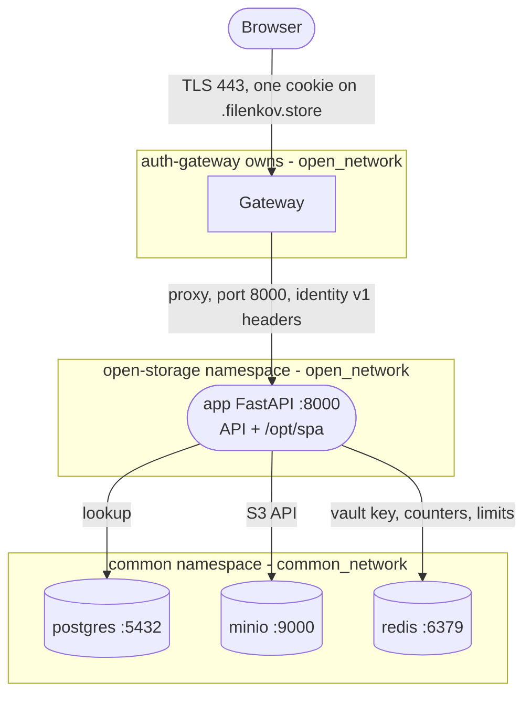

# open-storage

Storage product: files, photos, an encrypted private vault, uploaded resumes, generated-image history, quotas and admin. This namespace runs `app`. Postgres, Redis and MinIO are the [common](../common/init.md) services on `common_network`. The SPA source is built into the app image and is not a running service. The network decision is [ADR 3](adrs/3-app-on-common-data.md). The story that brought the tree here is [US-05](../user_stories/us-05-storage-namespace/init.md); the move onto `common_network` is [US-15](../user_stories/us-15-common-network/init.md). This page is service-level only. What a service does is linked.

## Services

| Service | Code | Role in the block | Does not |
|---|---|---|---|
| `app` | [app/init.md](app/init.md) | Owns every byte and every row of this product. Answers `/api/**`, `/health`, and the SPA shell. | Issue, verify or revoke identity; route hosts; terminate TLS; run Postgres, MinIO or Redis |
| SPA | [spa/init.md](spa/init.md) | The React front end, built into the `app` image and served from `/opt/spa` | Keep a session, hold a secret, or call anything but `app` on its own origin |

Database `db_storage`, bucket `storage`, and the vault key live in [common](../common/init.md): `postgres:5432`, `minio:9000`, `redis:6379`.

Contracts: [API](app/api-contract.md), [external calls](app/external-contract.md).

## Schema

`A -->|label| B` reads: A calls B; the label is the call. Rounded boxes run from this namespace; the square box is the neighbour. The app does not call User-Service.

## Networks

| Network | Why | Source |
|---|---|---|
| `open_network` (external) | The gateway reaches `app:8000` by name; it is the only inbound path. The same network is the condition under which the app may trust identity v1 headers. | [ADR 1](adrs/1-own-data-on-open-network.md), [identity v1](../auth-gateway/external-contracts/identity-v1.md), [upstreams](../auth-gateway/external-contracts/upstreams.md) |
| `common_network` (external) | The app reaches `postgres:5432`, `redis:6379` and `minio:9000`. RabbitMQ and Mongo are on this network; this app does not call them. | [ADR 3](adrs/3-app-on-common-data.md), [common](../common/init.md) |

`RAG_ENABLED=false`. The compose file does not join `rag_edge`, `user_network` or `auth_network`. It does not publish a host port. MinIO's host ports 9000 and 9001 are published by the common namespace.

## Mismatches

- [US-05](../user_stories/us-05-storage-namespace/init.md) task-02 and its Definition of Done say the compose file names no external network. The file follows [ADR 1](adrs/1-own-data-on-open-network.md) and task-04: `open_network` is `external: true`, and `app` joins only that network.
- [spa/init.md](spa/init.md) still names `frontend/` paths. The source tree is `src/open-storage/spa`.

## Identity this block consumes

The gateway authenticates `storage.filenkov.store` and forwards the request with the caller attached. The app reads the five v1 headers `X-Auth-Subject`, `X-Auth-Email`, `X-Auth-Name`, `X-Auth-Roles` and `X-Auth-Session`, plus an injected `Bearer`, and trusts them because it has no other inbound path. The User-Service client is gone. `users.id` is still a UUID column, so a non-UUID subject is not inserted.

`X-Auth-Roles` is projected onto the app's four-value storage role `STRANGER` / `FAMILY` / `ADMIN` / `BLOCKED`. The header set, the strip list and the header-trust condition are owned by [identity v1](../auth-gateway/external-contracts/identity-v1.md); the realm roles `admin` and `svc:storage:{admin,family,blocked}` by [idp roles](../auth-gateway/idp/init.md); the host, upstream and policy by [upstreams](../auth-gateway/external-contracts/upstreams.md) and [gateway config](../../src/auth-gateway/gateway/config.yaml). The decision is [ADR 2](adrs/2-trust-v1-headers.md).

Edge refusals are the edge's, in its own envelope `{"error":"<code>"}`; this block answers the app's envelope `{"detail":{"error_code","message"}}` for its own errors. A request refused at the edge never reaches `app`.

## Mismatches with the legacy project

The legacy product is WebStorage `~/projects/WebStorage`. The rows below are that tree, not this app. This app does not call User-Service and does not read `X-User-Id` or `X-Storage-Role`. Below, **legacy doc** is what the legacy documentation says, **code** is what the legacy tree does, **target** is what [identity v1](../auth-gateway/external-contracts/identity-v1.md), [idp](../auth-gateway/idp/init.md) or the gateway config require. Source: read of the legacy tree on 2026-11-22; every row names the file that says it.

### Identity and session

| # | Where (legacy file) | Legacy doc says | Code does | Target requires |
|---|---|---|---|---|
| 1 | `backend/app/presentation/dependencies/auth.py` | `docs/API Contract.md` lists `X-User-Id`, `X-Auth-User-Id`, `X-Storage-Role` | Reads `X-User-Id`, then `X-Auth-User-Id`, then `X-Storage-Role` | `X-Auth-Subject`; the other three are stripped before injection |
| 2 | `backend/app/presentation/dependencies/auth.py`, `backend/app/infrastructure/user_service/client.py` | `docs/external_contracts/user-service/init.md`: role from `GET /users/{id}/roles/storage` | Same call as fallback when `X-Storage-Role` is absent, 60 s in-process cache, `503 USER_SERVICE_UNAVAILABLE` when it fails | No directory. The role is a function of `X-Auth-Roles` |
| 3 | `backend/app/presentation/dependencies/auth.py` | `docs/external_contracts/auth-gateway/init.md`: a malformed id header is `500 AuthMisconfiguredError` | Unparseable UUID headers → `401`; only a malformed `X-Storage-Role` → `500` | The gateway never forwards a malformed identity header; the app's own rule is not a contract with the edge |
| 4 | `backend/app/infrastructure/user_service/client.py` | `docs/external_contracts/user-service/init.md`: `5xx`, timeout or unexpected format → `503` ("fail closed") | `_storage_role_from_services` / `get_storage_role` missing row → `Role.STRANGER` silently | No role is stranger, but never inferred from a failed lookup |
| 5 | `backend/app/domain/value_objects/role.py` | `docs/Master Document.md` §3 lists `STRANGER`, `FAMILY`, `ADMIN` only | `BLOCKED` exists and is enforced (`AuthBlockedError` → `403`) | `svc:storage:blocked` → `403` at the edge with `{"error":"blocked"}` |
| 6 | `backend/app/domain/value_objects/role.py` | `docs/external_contracts/auth-gateway/init.md` says `X-Auth-Role` is ignored | Correct: no header of that name is read | `X-Auth-Roles` (plural) is the only role input |
| 7 | `backend/app/presentation/dependencies/auth.py` | `docs/API Contract.md` §3 says `BLOCKED` is a value of `X-Storage-Role` | Correct, and also honoured from the User-Service answer | `X-Storage-Role` does not exist on the target path |
| 8 | `backend/app/presentation/dependencies/private.py`, `backend/config.py` | `docs/Data Models.md` §6: vault key at `private_key:{auth_session}` | Cookie `AUTH_COOKIE_NAME`, default `auth_session`, read server-side; Redis key `private_key:<cookie value>` | The session cookie is HttpOnly `__Secure-open_session`, `Domain=.filenkov.store`. `auth_session` is never set by the target. The key must be keyed on that cookie, read in-process |
| 9 | `backend/app/presentation/routers/private_router.py`, `lock_private_section` | `docs/API Contract.md` §7 labels `POST /api/private/lock` "Auth: Cookie present" | No `get_current_user` dependency: any caller holding the cookie can lock, and the cookie value names the Redis key | Identity headers only from the gateway; no route may act on a cookie alone |
| 10 | `backend/app/presentation/dependencies/auth.py`, `upsert_from_principal` | `docs/Data Models.md` §3/§4: `users.id` is the "User-Service UUID" | `users.id` = the header UUID and an email owned by another UUID is refused with `RuntimeError` → `500` | `X-Auth-Subject` is the key. After the cutover no `users.id` is a UUID the idp issues, so every email collides |
| 11 | `backend/app/presentation/dependencies/auth.py`, `user_repo.py` | `docs/API Contract.md` §10: admin list role is "live `storage_roles` from gRPC ListUsers" | No gRPC anywhere; roles come from HTTP User-Service `GET /users` | Header projection per request |

### Endpoint inventory

| # | Where (legacy file) | Legacy doc says | Code does | Note for the target |
|---|---|---|---|---|
| 12 | `backend/main.py`, `backend/app/infrastructure/session_store.py` | `docs/Test Spec.md` "do not test" lists `/api/auth/register`, `/api/auth/login` | Both, plus `/api/auth/google*` (3 routes), are retired and answer `410`; code path is untested | Four of 87 operations exist only to answer `410` |
| 13 | `backend/app/application/session_store.py` | `docs/Design Spec.md` §5: OAuth state/ticket in Redis | `oauth_state:`, `oauth_ticket:`, auth rate-limit keys exist but the only producer (`/api/auth/login`, `/register`) answers `410` | Dead state, not a contract |
| 14 | `backend/app/presentation/routers/auth_router.py` | `docs/Flow Spec.md` §2.3: logout via `POST /api/auth/logout` then hub redirect | `410 Gone`; neither the route nor the SPA logs out | Correct against the target; the frontend doc is wrong |
| 15 | `backend/app/presentation/routers/generated_router.py` | `docs/API Contract.md` §11 calls `generatedApi.ts` the client with "no create" | UI lists, opens and deletes; `POST /api/generated` is the only writer, called by the image generator as a tenant | The producer is outside this namespace and outside the gateway |
| 16 | `backend/app/presentation/routers/admin_router.py`, `get_storage_health` / `run_backup` / `run_maintenance` | `docs/API Contract.md` §10 documents all three | Mounted as `GET` and they change state (backup writes an object; maintenance deletes rows and blobs) | Same as is: a read-named write |
| 17 | `backend/app/presentation/routers/admin_router.py`, `update_user_role` | `docs/Master Document.md` §4: ADMIN may "change roles" | `PATCH /api/admin/users/{user_id}/role` is `410` | Roles change through the gateway Admin API, not here |
| 18 | `backend/app/presentation/routers/admin_router.py`, `update_user_quota` | `docs/Flow Spec.md` §7: "Private quota — Edit GB" | Frontend edits both `limit_mb` and `private_limit_gb` (`AdminPage.tsx` 168, 182) | Fine; the legacy label hides the total cap |
| 19 | `backend/app/presentation/routers/indexing_router.py` | `docs/API Contract.md` §6 puts `GET /api/photos/search` under "Photos — `/api/photos`" | Lives on the `indexing` router, tag `indexing`, prefix `""` | Two route groups, one path space |
| 20 | `docs/backend/api.md` | table lists Indexing and Admin indexing as `/api/indexing`, ADMIN | `GET /api/admin/indexing` is on the same router, so `/api/admin/indexing*` is not on the admin router | An admin route outside the admin router, with a second admin gate |

### Auth chain of revocation

| # | Where (legacy file) | Legacy doc says | Code does | Target |
|---|---|---|---|---|
| 21 | `backend/app/presentation/routers/admin_router.py`, `block_user` | `docs/Master Document.md` §4, `docs/Flow Spec.md` §7: admin blocks a user | Sets `users.is_active = false` in the app's own table. Nothing awaits `is_active`: blocking changes nothing | A block is `svc:storage:blocked` in the idp, enforced at the edge |
| 22 | `backend/app/infrastructure/user_service/client.py` | `docs/external_contracts/user-service/init.md` "fail closed" | A cached role survives a revoke for up to 60 s; a User-Service outage freezes it for the process lifetime | The edge decides per request; a revoked role is gone on the next request |

### Files, photos, vault

| # | Where (legacy file) | Legacy doc says | Code does | Target |
|---|---|---|---|---|
| 23 | `backend/app/application/indexing/immediate.py`, `presentation/indexing_notify.py` | `docs/Design Spec.md` §5: "Request-path hooks … only insert or update `file_index_links` … The job is what talks to RAG" | Upload and delete call RAG inline after their own commit, in a second session, on the request path | The doc's single-writer rule for RAG calls is already broken in code |
| 24 | `backend/app/main.py` | `docs/Design Spec.md` §5 and `docs/backend/init.md`: `db_backup` 02:00, `reconcile_quotas` 04:00 hourly, `cleanup_pending` 1h, `cleanup_tmp` 1h | `add_job` runs once, for `index_sync`. The other four are never registered; they run only from `GET /api/admin/maintenance/run` and `GET /api/admin/backup/run` | See [scheduled jobs](app/init.md#scheduled-jobs). No cleanup, reconcile or backup ever runs on its own |
| 25 | `backend/app/application/indexing/`, `backend/app/domain/entities/file_record.py` | `docs/Design Spec.md` §7 lists no indexing flag; `docs/Flow Spec.md` §5b: "While it is false, enqueue writes no `file_index_links` row" | `RAG_ENABLED=false` still creates `PENDING` link rows on every upload; the job and the startup pass are what draw the line | The doc and the flag disagree about what "off" means |
| 26 | `backend/app/presentation/routers/file_router.py` | `docs/external_contracts/minio/init.md`: staging sits "inside a section", i.e. `users/{id}/files/.tmp/` | `FileService.TMP_DIR` is joined to the section root, so files staging lands at `users/{id}/.tmp/{record_id}` | Key layout is part of the RAG contract; the doc names a key that is never written |
| 27 | `backend/app/domain/indexing.py`, `application/ports/rag_index.py` | `docs/Design Spec.md` §5: "A content change deletes the vectors, registers again, and resets `attempts` to 0" | `RagIndexClient` has no combined call, so it is two ticks; a crash between them leaves a row whose vectors are gone | Not target-blocking; a retry window exists |
| 28 | `backend/app/presentation/routers/private_router.py` | `docs/API Contract.md` §7: private file ops "require active private session", missing key → `401 PRIVATE_SESSION_EXPIRED` | `_get_session_id` raises `401 UNAUTHORIZED` when the cookie is absent | With the new cookie, a missing cookie is a missing session: `UNAUTHORIZED` is right, `PRIVATE_SESSION_EXPIRED` is what the SPA expects |
| 29 | `backend/app/presentation/routers/private_router.py`, `download_private_folder` | `docs/API Contract.md` §7 | Builds `Content-Disposition` by hand (`attachment; filename="…"`), not through `build_attachment_content_disposition` | Every other router uses the helper; non-ASCII folder names break |
| 30 | `backend/app/presentation/routers/private_router.py`, `reset_private_storage` | `docs/API Contract.md` §7: reset "Only when unlock rate-limited" | Correct, and it is `403` otherwise | As is |
| 31 | `backend/app/application/photo_service.py` | `docs/Flow Spec.md` §5 formats: "JPEG, PNG, HEIC, WEBP, GIF" | `.heif` is also accepted | Minor; five vs six extensions |
| 32 | `backend/app/presentation/routers/photo_router.py` | `docs/API Contract.md` §6: preview is "JPEG (or original mime)" | Preview is always `image/jpeg`; the original is the second endpoint | As is |

### Quota and shared storage

| # | Where (legacy file) | Legacy doc says | Code does | Target |
|---|---|---|---|---|
| 33 | `backend/app/presentation/dependencies/shared.py` | `docs/API Contract.md` §5: "Delete: owner or ADMIN only → else `403`" | `DELETE` whose path has no `file_records` row goes straight to `adapter.delete` and removes bytes it does not own. The owner rule is applied only when the row is found by section path | Any writer of `shared/` other than FileService can have its bytes deleted |
| 34 | `backend/app/application/file_service.py`, `_purge_duplicate_records` | `docs/API Contract.md` §5: one row per key | Deletes siblings for the same key; owner filter is `None` for `SHARED`, so one user's delete purges another's record | Files always carry `user_id`, shared does not |
| 35 | `backend/app/infrastructure/database/repositories/file_repo.py`, `delete` | `docs/Data Models.md` §4: "A normal user delete sets `status = DELETED` and leaves the row" | A row that is never hard-deleted (only stale `PENDING` is) leaks one row per deleted file, forever | Table size grows without a reaper |
| 36 | `backend/config.py`, `models.py` | `docs/Master Document.md` §4: default quota `DEFAULT_USER_QUOTA_MB` | `BusinessLogicSettings.default_user_quota_mb` is read by `user_repo`/`quota_repo`; `models.DEFAULT_USER_QUOTA_BYTES` (100 MiB) is the column default | Two owners of one default; the setting wins, the model constant is dead |

### App vs. edge errors and headers

| # | Where (target file) | What differs |
|---|---|---|
| 37 | [identity v1](../auth-gateway/external-contracts/identity-v1.md) | The app answers `{"detail":{"error_code","message"}}` for every error, including `401` and `503`. The edge answers `{"error":"<snake_case>"}`. One origin, two envelopes; the SPA parses only the first. |
| 38 | [gateway API contract](../auth-gateway/gateway/api-contract.md) | On every response the gateway adds `X-Frame-Options`, `X-Content-Type-Options`, `Referrer-Policy`, `Permissions-Policy`. The app sets none of them; a duplicated header would be a defect, and the app must not add one. |
| 39 | [upstreams](../auth-gateway/external-contracts/upstreams.md) | The edge timeout for this host is `response_header: 30m`. The app has no request timeout of its own; a hung `pg_dump` in `GET /api/admin/backup/run` holds a worker, not the route. |

## What this page does not own

- Service behaviour: [app/init.md](app/init.md), [spa/init.md](spa/init.md).
- Endpoints: [app/api-contract.md](app/api-contract.md).
- Dependencies and what each must satisfy: [app/external-contract.md](app/external-contract.md).
- Header names, strip list, roles: [identity v1](../auth-gateway/external-contracts/identity-v1.md), [idp roles](../auth-gateway/idp/init.md).
- Where a request enters: [docs/init.md](../init.md), [upstreams](../auth-gateway/external-contracts/upstreams.md).
- The storage host declaration and the tests that lock it: [edge.md](edge.md).
