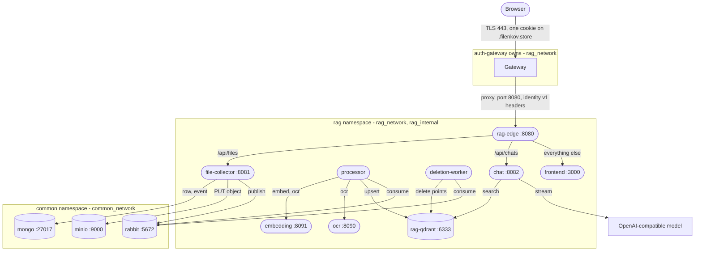

# rag

Retrieval-augmented chat over a user's own documents: upload, OCR, chunk, embed, index, ask. The namespace was moved in from the repository `RAG-Chat` by [US-16](../user_stories/us-16-rag-namespace/init.md); the decision is [ADR-0009](../../adrs/9-rag-namespace.md). Mongo, MinIO and RabbitMQ are the [common](../common/init.md) services.

## Services

| Service | Code | Role in the block | Does not |
|---|---|---|---|
| `rag-edge` | `rag-edge` | The one inbound path. Splits `/api/files` to the file collector, `/api/chats` to chat, everything else to the frontend. Streams SSE unbuffered. | Own a user, store a document, verify a JWT |
| `file-collector` | `file-collector` | Upload, list, content, delete. Writes the object to the `storage` bucket and the row to Mongo, then emits an event. | OCR, chunk, embed |
| `processor` | `processor` | Consumes the document event: extract text, OCR a scan, chunk, embed, upsert into Qdrant, mark `ready`. | Serve HTTP, decide identity |
| `deletion-worker` | `deletion-worker` | Consumes the delete event: Qdrant points, the object, the rows. | Serve HTTP |
| `chat` | `chat` | Retrieve, call the model, stream SSE, keep the chat. `GET /api/chats/image-search` also lives here. | Write or delete a document |
| `frontend` | `frontend` | The Vite React UI, served by nginx. | Hold a session, call anything but its own origin |
| `embedding` | `embedding` | `POST /embed` and `POST /embed/image` over `llama-server` in the same container. Batch 16, dimension 768. | Publish a port, know a user |
| `ocr` | `ocr` | `POST /ocr` over `llama-server` with the OCR model, one image at a time. | Publish a port, know a user |
| `rag-qdrant` | — | Qdrant `v1.13.4`, two collections (`QDRANT_COLLECTION`, `QDRANT_IMAGES_COLLECTION`). | Leave this namespace |

## Schema

`A -->|label| B` reads: A calls B; the label is the call. Rounded boxes run from this namespace; square boxes are neighbours.

## Networks

| Network | Why | Source |
|---|---|---|
| `rag_network` | The edge hop: the gateway reaches `rag-edge:8080` by name and it is the only inbound path. The services trust identity v1 headers only under this condition. Created by this namespace. | [ADR-0009](../../adrs/9-rag-namespace.md), [identity v1](../auth-gateway/external-contracts/identity-v1.md) |
| `rag_internal` | Service-to-service inside the stack: edge to collector, chat, frontend; processor and deletion-worker to Qdrant, embedding, OCR. Not reachable from outside. | [ADR-0009](../../adrs/9-rag-namespace.md) |
| `common_network` (external) | Mongo `mongo:27017`, MinIO `minio:9000`, RabbitMQ `rabbit:5672`. Joined by file-collector, processor, deletion-worker and chat. | [common](../common/init.md), [ADR-0008](../../adrs/8-common-data-services.md) |

No container publishes a host port. No container joins `models_network` or `llm_network`.

The gateway side of the edge hop is declared in `deploy/auth-gateway/docker-compose.yaml` under the same name, `rag_network`, `external: true`: the gateway joins the network this namespace creates. Until `rag-rag-edge` runs on it, `GET https://rag.filenkov.store/health` answers `502 {"error":"bad_gateway"}` because the upstream does not exist yet; that is the expected answer for a host whose upstream is not up, not a mismatch. The decision is [ADR-0011](../../adrs/11-gateway-joins-rag-network.md).

## Identity this block consumes

The gateway authenticates `rag.filenkov.store` and forwards the request with the caller attached. The edge and every service behind it read `X-Auth-Subject` as the user key and `X-Auth-Roles` for the role family `svc:rag:{admin,family,blocked}`. The header set, the strip list and the header-trust condition are owned by [identity v1](../auth-gateway/external-contracts/identity-v1.md); the host, upstream and policy by [upstreams](../auth-gateway/external-contracts/upstreams.md) and the gateway config.

`X-Auth-Subject` must be a canonical lower-case UUID and stable per person, because `user_id` in Mongo and in Qdrant is that value. This is the external condition recorded in [US-16](../user_stories/us-16-rag-namespace/init.md) D6. The gateway writes `sub` from the verified token unchanged (`oidc/verifier.go`), and a Keycloak realm created from `src/auth-gateway/idp/realm.json` issues a random UUID as `sub`, so the condition holds on a realm built from that file and not on one whose users were migrated from another idp. `rag_common/auth.py` accepts any UUID text and rejects everything else with `401`.

## Mismatches

- The legacy tree `~/projects/RAG-Chat` is written against a different identity: `docs/gateway.md` there states that the gateway injects `X-Auth-User-Id` and `X-Auth-Role` (value `global_role`), and `file-collector`'s README says the same. Identity v1 injects `X-Auth-Subject` and `X-Auth-Roles`. The rows below are what the legacy tree says and does, and what this namespace requires.

| # | Where (legacy file) | Legacy doc says | Code does | This namespace requires |
|---|---|---|---|---|
| 1 | `docs/gateway.md`, `services/file-collector/README.md`, `services/chat/README.md` | `X-Auth-User-Id` is the only user key; `X-Auth-Role: BLOCKED` is `403` | `rag_common/auth.py`, `chat/auth.py` read exactly those two | `X-Auth-Subject`, `X-Auth-Roles` ([identity v1](../auth-gateway/external-contracts/identity-v1.md)) |
| 2 | `docs/gateway.md` | The user id is "the User-Service UUID"; a non-UUID is `401` | `canonical_uuid` refuses anything else | A UUID, from the edge (US-16 D6) |
| 3 | `docs/gateway.md` | The gateway writes the host block into "deploy/gateway.yaml" | That file is not in this repository | [upstreams](../auth-gateway/external-contracts/upstreams.md), gateway `config.yaml` |
| 4 | `docker-compose.yml` | Networks are `rag_internal` and `rag_edge` | Also joins `common_network`, `models_network`, `llm_network` | `rag_network`, `rag_internal`, `common_network` |
| 5 | `docker-compose.yml` | MinIO and RabbitMQ are external; Mongo and Qdrant are local | One local `rag-mongo` with the `rag-mongo` alias | Mongo from [common](../common/init.md); Qdrant local as `rag-qdrant` |
| 6 | `AGENTS.md` (legacy) | Says "Auth Gateway and LLM are not moved into this repository" | — | Holds: the move is the code, not the edge |
| 7 | `services/*/node_modules`, `.venv`, `.pytest_cache`, `.ruff_cache` | — | A large amount of it is tracked in the legacy repository | Excluded by `src/rag`'s ignore rules |

## What this page does not own

- A service's behaviour: `rag-edge`, `chat`, and the rest of the table above.
- Endpoints: the old tree's `docs/openapi.yaml` and `docs/api.md` until this namespace's API contract page exists.
- Dependencies and what each must satisfy: [external-contract.md](external-contract.md).
- Where a request enters: [docs/init.md](../init.md), [upstreams](../auth-gateway/external-contracts/upstreams.md).
